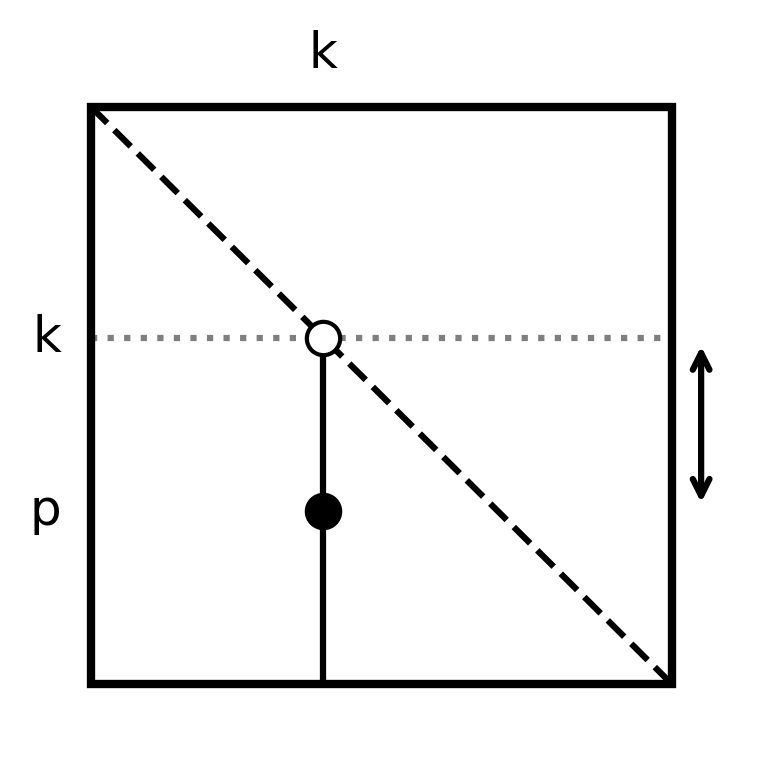
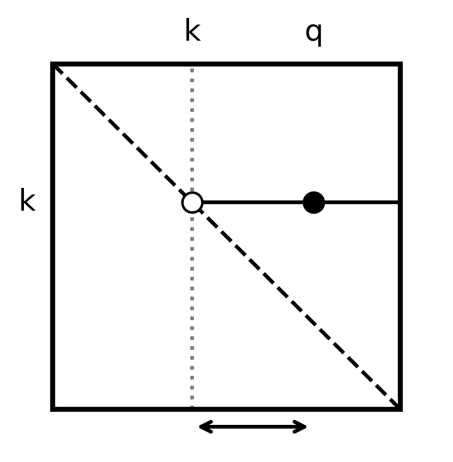
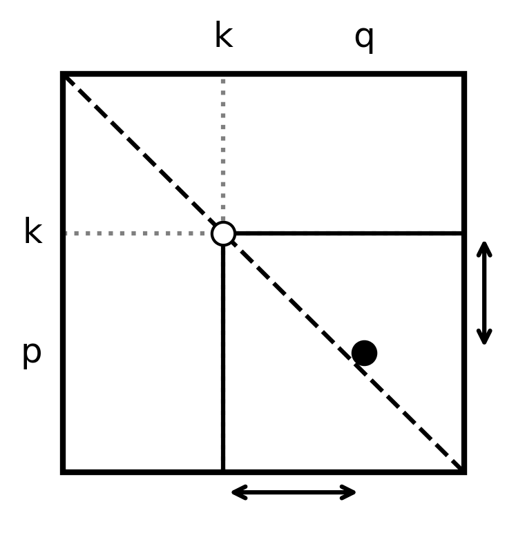

## Матрицы с диагональным преобладанием

Говорят, что матрица $A = [a_{ij}]_{n \times n}$ имеет **строгое диагональное преобладание**, если:
$$\vert{}a_{ii}\vert{} > \sum_{\substack{j=1 \\ j \neq i}}^n \vert{}a_{ij}\vert{}; \quad i = \overline{1,n} \quad (5)$$


Предположим, матрица $A$ обладает строгим диагональным преобладанием.
В частности, для первой строки:
$$\vert{}a_{11}\vert{} > \sum_{j=2}^n \vert{}a_{1j}\vert{} \implies a_{11} \neq 0$$


Разделим обе части на $\vert{}a_{11}\vert{} \neq 0$:
$$\sum_{j=2}^n \vert{}u_{1j}\vert{} = \sum_{j=2}^n \left\vert{} \frac{a_{1j}}{a_{11}} \right\vert{} < 1$$


После завершения 1-го шага метода Гаусса приходим к системе (3), матрица которой имеет вид:
$$A^{(1)} = \begin{bmatrix} 1 & u_{12} & \dots & u_{1n} \\ 0 & a_{22}^{(1)} & \dots & a_{2n}^{(1)} \\ \vdots & \vdots & \ddots & \vdots \\ 0 & a_{n2}^{(1)} & \dots & a_{nn}^{(1)} \end{bmatrix}$$


Покажем, что выделенная подматрица также имеет строгое диагональное преобладание, а именно:
$$\vert{}a_{ii}^{(1)}\vert{} > \sum_{\substack{j=2 \\ j \neq i}}^n \vert{}a_{ij}^{(1)}\vert{}; \quad i = \overline{2,n}$$


Используя формулы пересчета, получим:
$$\vert{}a_{ii}^{(1)}\vert{} = \vert{}a_{ii} - a_{i1} u_{1i}\vert{} \ge \vert{}a_{ii}\vert{} - \vert{}a_{i1}\vert{} \cdot \vert{}u_{1i}\vert{} > \sum_{\substack{j=1 \\ j \neq i}}^n \vert{}a_{ij}\vert{} - \vert{}a_{i1}\vert{} \cdot \vert{}u_{1i}\vert{} =$$

$$= \vert{}a_{i1}\vert{} + \sum_{\substack{j=2 \\ j \neq i}}^n \vert{}a_{ij}\vert{} - \vert{}a_{i1}\vert{} \cdot \vert{}u_{1i}\vert{} = \sum_{\substack{j=2 \\ j \neq i}}^n \vert{}a_{ij}^{(1)} + a_{i1} u_{1j}\vert{} + \vert{}a_{i1}\vert{} - \vert{}a_{i1}\vert{} \cdot \vert{}u_{1i}\vert{} \ge$$

$$\ge \sum_{\substack{j=2 \\ j \neq i}}^n \vert{}a_{ij}^{(1)}\vert{} - \sum_{\substack{j=2 \\ j \neq i}}^n \vert{}a_{i1}\vert{} \cdot \vert{}u_{1j}\vert{} + \vert{}a_{i1}\vert{} - \vert{}a_{i1}\vert{} \cdot \vert{}u_{1i}\vert{} =$$

$$= \sum_{\substack{j=2 \\ j \neq i}}^n \vert{}a_{ij}^{(1)}\vert{} - \sum_{j=2}^n \vert{}a_{i1}\vert{} \cdot \vert{}u_{1j}\vert{} + \vert{}a_{i1}\vert{} =$$

$$= \sum_{\substack{j=2 \\ j \neq i}}^n \vert{}a_{ij}^{(1)}\vert{} + \vert{}a_{i1}\vert{} \left( 1 - \sum_{j=2}^n \vert{}u_{1j}\vert{} \right) > \sum_{\substack{j=2 \\ j \neq i}}^n \vert{}a_{ij}^{(1)}\vert{}$$


$$\implies \vert{}a_{ii}^{(1)}\vert{} > \sum_{\substack{j=2 \\ j \neq i}}^n \vert{}a_{ij}^{(1)}\vert{}$$


Продолжая процесс, убеждаемся, что $a_{kk}^{(k-1)} \neq 0$ для $k = \overline{3,n}$.

> 💡 **Объяснение:** Это важнейшее свойство. Оно доказывает, что если исходная матрица имела преобладание диагонали, то при выполнении метода Гаусса мы **никогда не столкнемся с делением на ноль**. Главные элементы (на диагонали) всегда будут отличны от нуля на каждом шаге.

---

## Метод Гаусса с выбором главного элемента

Метод Гаусса имеет недостаток - требование отличия от нуля главных элементов. Если на некотором шаге $a_{kk}^{(k-1)} = 0$, то алгоритм становится формально непригодным.

Существуют 3 стратегии выбора главного элемента:

**1. По столбцу**
$$\vert{}a_{pk}^{(k-1)}\vert{} = \max_{k \le i \le n} \vert{}a_{ik}^{(k-1)}\vert{}$$

Переставляем местами $k$-ую и $p$-ую строки. $a_{pk}^{(k-1)}$ — главный эл. $k$-ого шага.



**2. По строке**
$$\vert{}a_{kq}^{(k-1)}\vert{} = \max_{k \le j \le n} \vert{}a_{kj}^{(k-1)}\vert{}$$

Переставляем $k$-ый и $q$-ый столбцы, $a_{kq}^{(k-1)}$ — главный эл. $k$-ого шага. При этом происходит перестановка неизвестных: $x_k \leftrightarrow x_q$.



**3. Полный выбор**
$$\vert{}a_{pq}^{(k-1)}\vert{} = \max_{k \le i, j \le n} \vert{}a_{ij}^{(k-1)}\vert{}$$

Переставляем $k$-ую и $p$-ую строки, и $k$-ый и $q$-ый столбцы. $a_{pq}^{(k-1)}$ — главный эл. $k$-ого шага, при этом $x_k \leftrightarrow x_q$.



На $k$-ом шаге (при полном выборе) нужно сравнить $(n-k)^2$ элементов.
При $n$ шагах: $\sum_{k=1}^n (n-k)^2 \sim \frac{1}{3} n^3$.

> 💡 **Объяснение:** Выбор главного элемента нужен не только для спасения от деления на точный ноль. Деление на очень маленькое число (близкое к нулю) приводит к катастрофическому росту вычислительной погрешности (из-за округлений компьютера). Выбирая максимальный по модулю элемент, мы делаем множители пересчета минимальными, что сохраняет высокую точность вычислений.

---

## Метод Холесского (Метод квадратного корня)

*(01.10.26г.)*

Пусть $Ax = b$, где $A$ - симметричная положительно определённая матрица, т.е. $A^T = A > 0$.
Тогда угловые миноры строго положительны: $A \binom{1 \ 2 \ ... \ k}{1 \ 2 \ ... \ k} > 0 \quad k = \overline{1,n}$.

Матрицу $A$ можно представить единственным образом как: $A = LU$, где
$$L = \begin{bmatrix} l_{11} & & 0 \\ l_{21} & l_{22} & \\ \dots & \dots & \dots \\ l_{n1} & l_{n2} & \dots & l_{nn} \end{bmatrix} \quad (\forall l_{ii} \neq 0); \quad U = \begin{bmatrix} 1 & u_{12} & \dots & u_{1n} \\ & 1 & \dots & u_{2n} \\ 0 & & \ddots & \vdots \\ & & & 1 \end{bmatrix}$$

Покажем, что т.к. $A > 0$, то $l_{ii} > 0 \quad \forall i = \overline{1,n}$.
Блочное умножение:
$$ \begin{bmatrix} A_k & \dots \\ \dots & \dots \end{bmatrix} = \begin{bmatrix} L_k & 0 \\ \dots & \dots \end{bmatrix} \begin{bmatrix} U_k & \dots \\ 0 & \dots \end{bmatrix} $$
$$A_k = L_k \cdot U_k \implies \det A_k = \det L_k \cdot \det U_k$$
$$A \binom{1 \ 2 \ ... \ k}{1 \ 2 \ ... \ k} = l_{11} \cdot l_{22} \cdot ... \cdot l_{kk} \cdot 1$$
$$A \binom{1 \ 2 \ ... \ k-1}{1 \ 2 \ ... \ k-1} = A \binom{1 \ 2 \ ... \ k-1}{1 \ 2 \ ... \ k-1} \cdot l_{kk}$$ *(Примечание: здесь описка в конспекте, имеется в виду $l_{11} \dots l_{k-1,k-1}$)*
$$\implies l_{kk} = \frac{A \binom{1 \ 2 \ ... \ k}{1 \ 2 \ ... \ k}}{A \binom{1 \ 2 \ ... \ k-1}{1 \ 2 \ ... \ k-1}} > 0 \quad \forall k = \overline{1,n}$$

$i$-ый столбец матрицы $L$ разделим на $l_{ii}$ и умножим эту матрицу на $D = \begin{bmatrix} l_{11} & & 0 \\ & \dots & \\ 0 & & l_{nn} \end{bmatrix}$.
$$L = \begin{bmatrix} 1 & & 0 \\ l_{21}/l_{11} & 1 & \\ \dots & \dots & 1 \\ l_{n1}/l_{11} & l_{n2}/l_{22} & \dots & 1 \end{bmatrix} \cdot \begin{bmatrix} l_{11} & & 0 \\ & l_{22} & \\ 0 & & l_{nn} \end{bmatrix} \equiv \tilde{L} \cdot D$$

$L = \tilde{L} \cdot D \implies A = \tilde{L} D U$.
$A^T = U^T D^T \tilde{L}^T = U^T D \tilde{L}^T = \tilde{L} D U$ (т.к. $A = A^T$).
Но т.к. разложение единственно $\implies \tilde{L} = U^T \implies A = U^T D U$.

Рассмотрим $D^{\frac{1}{2}} = \begin{bmatrix} \sqrt{l_{11}} & & 0 \\ & \sqrt{l_{22}} & \\ 0 & & \sqrt{l_{nn}} \end{bmatrix}$.
$D^{\frac{1}{2}} \cdot D^{\frac{1}{2}} = D$.
$A = U^T \cdot D^{\frac{1}{2}} \cdot D^{\frac{1}{2}} \cdot U$.

Введём $V = D^{\frac{1}{2}} \cdot U$.
$$V = \begin{bmatrix} \sqrt{l_{11}} & & 0 \\ & \dots & \\ 0 & & \sqrt{l_{nn}} \end{bmatrix} \cdot \begin{bmatrix} 1 & \dots & \dots \\ 0 & 1 & \dots \\ 0 & & 1 \end{bmatrix} = \begin{bmatrix} \sqrt{l_{11}} & \dots & \dots \\ & \dots & \dots \\ 0 & & \sqrt{l_{nn}} \end{bmatrix}$$

$$A = \underbrace{U^T \cdot D^{\frac{1}{2}}}_{V^T} \cdot \underbrace{D^{\frac{1}{2}} \cdot U}_{V}$$
**$$\implies A = V^T \cdot V$$**

Решение системы:
$$Ax = b \implies V^T V x = b \implies \begin{cases} V^T y = b \\ Vx = y \end{cases}$$

**Теорема:**
Симметричную положительно определённую матрицу $A$ можно единственным образом представить в виде $A = V^T V$, где $V$ - верхняя треугольная матрица с положительными диагональными элементами.

**Вывод расчетных формул:**
$$i \le j: \quad a_{ij} = \sum_{k=1}^i (V^T)_{ik} \cdot (V)_{kj} = \sum_{k=1}^i v_{ki} \cdot v_{kj}$$

Пусть $i$ - фиксировано, $j = \overline{i, n}$
*   $j = i: \quad a_{ii} = \sum_{k=1}^i v_{ki}^2 = \sum_{k=1}^{i-1} v_{ki}^2 + v_{ii}^2$
*   $j = \overline{i+1, n}: \quad a_{ij} = \sum_{k=1}^i v_{ki} v_{kj} = \sum_{k=1}^{i-1} v_{ki} v_{kj} + v_{ii} v_{ij}$

Тогда получаем формулы пересчета:
$$j = i: \quad v_{ii} = \sqrt{a_{ii} - \sum_{k=1}^{i-1} v_{ki}^2}$$
$$j > i: \quad v_{ij} = \frac{a_{ij} - \sum_{k=1}^{i-1} v_{ki} v_{kj}}{v_{ii}}$$

**Псевдокод (Метод Холесского):**
```text
input n, (a_{ij})
v_{11} = \sqrt{a_{11}}
for j = 2 .. n
    v_{1j} = a_{1j} / v_{11}
end
for i = 2 .. n
    v_{ii} = \sqrt{a_{ii} - \sum_{k=1}^{i-1} v_{ki}^2}
    for j = i+1 .. n
        v_{ij} = (a_{ij} - \sum_{k=1}^{i-1} v_{ki} * v_{kj}) / v_{ii}
    end
end
output (v_{ij})
```

**$$A_{ops} \sim \frac{1}{3} n^3$$**

> 💡 **Объяснение:** Метод Холесского — это узкоспециализированная, но невероятно быстрая версия метода Гаусса для симметричных матриц. Благодаря симметрии нам нужно считать элементы только над диагональю, поэтому количество операций падает в два раза (с $\frac{2}{3} n^3$ до $\frac{1}{3} n^3$). Это огромная экономия времени для больших систем.

---

### Число обусловленности матрицы $V$

Пусть собственные числа $\lambda_i$ матрицы $A$ пронумерованы: $\lambda_{\min} = \lambda_1 \le \lambda_2 \le ... \le \lambda_n = \lambda_{\max}$.
$$K_2(A) = ||A||_2 \cdot ||A^{-1}||_2 \quad K_2(A) = \frac{\lambda_{\max}}{\lambda_{\min}}$$

Найдём число обусловленности для матрицы $V$:
$$K_2(V) = ||V||_2 \cdot ||V^{-1}||_2$$
$$||V||_2 = \sqrt{\lambda_{\max}(V^T V)} = \sqrt{\lambda_{\max}(A)} = \sqrt{\lambda_{\max}}$$
$$||V^{-1}||_2 = \sqrt{\lambda_{\max}((V^{-1})^T V^{-1})} = \sqrt{\lambda_{\max}((V^T)^{-1} V^{-1})} = \sqrt{\lambda_{\max}((V V^T)^{-1})} =$$
$$= \frac{1}{\sqrt{\lambda_{\min}(V V^T)}} = \left[ V^{-1} (V V^T) V = V^T V \implies \text{матрицы подобные} \right] =$$
$$= \frac{1}{\sqrt{\lambda_{\min}(V^T V)}} = \frac{1}{\sqrt{\lambda_{\min}(A)}} = \frac{1}{\sqrt{\lambda_{\min}}}$$

Итого получаем:
**$$K_2(V) = \sqrt{\frac{\lambda_{\max}}{\lambda_{\min}}} = \sqrt{K_2(A)}$$**

> 💡 **Объяснение:** Этот факт делает метод Холесского еще более крутым. Разложение $A = V^T V$ улучшает обусловленность: число обусловленности матрицы $V$ равно *корню* из числа обусловленности исходной матрицы $A$. То есть, если система $A$ была очень плохо обусловлена (например, $K(A) = 10^4$), то после разложения мы решаем две системы с матрицами $V^T$ и $V$, у которых число обусловленности всего лишь $10^2$. Это существенно снижает влияние вычислительных погрешностей!

---
